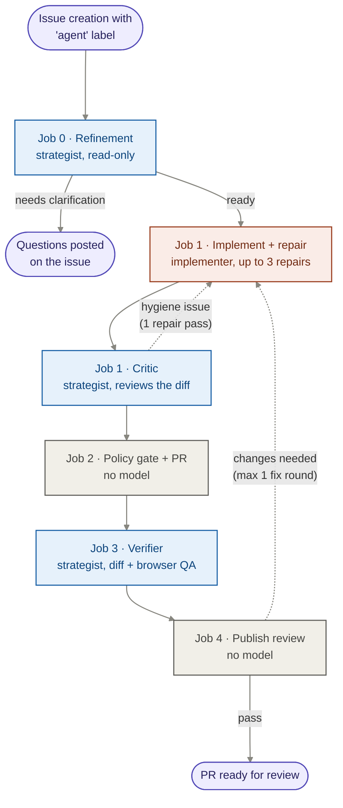

# Repo2Ship

**Build, verify, and ship with your coding agents.**

Repo2Ship is an open-source, GitHub-native coding pipeline you can drop into a repository. You write an issue, and the pipeline:

1. **Refines** it into testable acceptance criteria, or asks you clarifying questions on the issue.
2. **Implements** it with [`pi`](https://www.npmjs.com/package/@earendil-works/pi-coding-agent) or [OpenCode](https://opencode.ai) on a throwaway Actions runner, running your verify command after each attempt (up to 3 repair rounds).
3. **Gates** the patch with a deterministic policy check (no model involved) and opens a PR.
4. **Verifies** the PR in a separate verifier run that reviews the diff and runs browser QA per acceptance criterion against the running app.
5. **Fixes** at most one round of verifier findings automatically, then leaves the merge to a human.

Every run's trajectory, token counts and cost are sent to [Langfuse](https://langfuse.com) (optional), and merged/closed agent PRs are scored there so you can compare models over time.

The repo ships with a small demo app (a task tracker) so the pipeline has something to work on out of the box.

**Status:** early-stage developer tooling. Local tests cover the pipeline and demo; Amazon Bedrock has not been live-tested. Review generated code before merging. Model providers and GitHub Actions may incur charges. See [Security](SECURITY.md) for the trust boundaries and [Contributing](CONTRIBUTING.md) to work on Repo2Ship.

---

## How it works



Blue steps use the **strategist** model, orange the **implementer**, gray no model at all. Comments with `@pi` on a PR and PR reviews skip refinement and start at Job 1.

### Which model runs where

| Step | Job | Model role | Runs per issue |
| :--- | :--- | :--- | :--- |
| Refinement | 0 | Strategist | 1 (issue triggers only) |
| Implement + repair | 1 | Implementer | 1, plus up to 3 repairs if verify fails |
| Critic | 1 | Strategist | 1 when the two models differ or `ENABLE_CRITIC=true` |
| Critic repair pass | 1 | Implementer | 0–1, only if the deterministic hygiene check fails |
| Policy gate + PR | 2 | None | 1 |
| Verifier | 3 | Strategist | 1 |
| Publish review | 4 | None | 1 |
| Fix round | 1–4 again | Both | 0–1, when the verifier asks for changes |

Set `IMPLEMENTER_MODEL` and optionally `STRATEGIST_MODEL` to models available from your provider. The strategist falls back to the implementer when unset; there is no built-in default model. Engine selection (`pi` or `opencode`) is independent of the provider. Both roles share the configured provider and credentials.

| Path | What it is |
| :--- | :--- |
| `.github/workflows/pi-agent.yml` | The pipeline (jobs 0–4 above) |
| `.github/workflows/release.yml` | Validates version tags, runs full verification, and publishes GitHub releases |
| `.github/workflows/ci.yml` | CI: typecheck, unit tests, Playwright e2e on PRs and `main` |
| `.github/workflows/agent-outcome.yml` | Scores closed `agent/*` PRs in Langfuse |
| `.github/ISSUE_TEMPLATE/agent-task.yml` | Issue form: goal, context, acceptance criteria, out of scope |
| `.github/CODEOWNERS` | Requires owner review on pipeline, config and test paths |
| `scripts/agent/` | Pipeline scripts: model setup, runner, critic, refinement, verifier, policy gate, Langfuse export |
| `scripts/agent/prompts/` | Prompts for the refinement and verifier agents |
| `.pi/pipeline.json` | **Per-project config**: verify commands, how to start the app, URL, UI paths, protected paths |
| `AGENTS.md` (`CLAUDE.md` symlink) | Instructions the agent reads on every task |
| `src/`, `public/`, `scripts/dev-server.mjs`, `tests/` | Demo app and its tests |

### Choosing models

**Recommended starting point: use two different models for implementation and strategy.** If cost is a concern, choose a cheaper model that is capable of working on your codebase as the **implementer**, and reserve a stronger reasoning and review model for the **strategist**. The implementer writes code and handles repair attempts; the strategist refines requirements, critiques changes, and verifies the result. This lets you concentrate more expensive model calls on planning and review, though total cost still depends on context size and the number of repair rounds.

Even when cost is not the main concern, a two-model approach can be beneficial. Different models can bring different assumptions, failure patterns, and coding-style preferences. A reviewer using a different model may catch mistakes the implementing model overlooks when reviewing its own work, and can challenge recurring biases instead of reinforcing them. This is a potential benefit, not a guarantee that every pair will outperform one model: both models can miss the same bug. Reviews should prioritize correctness, acceptance criteria, and the repository's conventions over either model's preferred style. Keep deterministic tests and human review in place.

For example, configure the two roles with actual model IDs available from your provider:

```dotenv
IMPLEMENTER_MODEL=your-cost-efficient-coding-model
STRATEGIST_MODEL=your-stronger-review-model
```

Both roles currently share the configured provider and credentials, so choose a provider or endpoint that exposes both models. Engine selection is independent: switching between Pi and OpenCode while using the same underlying model does not provide model diversity.

A one-model setup remains supported: leave `STRATEGIST_MODEL` unset to use the implementer's model for both roles. Start there if you need the simplest configuration, then compare model pairs using your own tasks, verification results, repair rounds, and optional Langfuse traces.

### Safety model

- Agent jobs run with read-only repository tokens and `persist-credentials: false`; model credentials are scoped to model-running steps. Bedrock can use a bearer token or short-lived AWS credentials. The verifier removes `MODEL_*`, `AWS_*`, and legacy provider credentials from the app process environment; this is environment filtering, not filesystem isolation.
- Pipeline scripts always run from `main`, never from the agent's branch.
- `pi` runs with `--no-approve --no-mcp`, so a repo can never make it load project-local extensions, settings or MCP servers from `.pi/`. `AGENTS.md` is still read.
- `opencode` runs with project config disabled, `--pure`, an isolated `HOME`, and a trusted inline config that sets providers and per-stage permissions, so a repo's `opencode.json` or `.opencode/` agents and plugins are never loaded. The policy gate also rejects patches that add them.
- The policy gate (`scripts/agent/validate-patch-policy.mjs`) checks the patch against `origin/main`:
  - **Rejects** changes to `.github/`, `scripts/agent/`, `AGENTS.md`, `CLAUDE.md`, `.pi/pipeline.json`, `.npmrc` files, the `protectedPaths` in `.pi/pipeline.json`, and any change to `package.json` scripts.
  - **Rejects** deleted test files and added `.skip`, `.only`, `.fixme`, `.todo`, `.skipIf`, or `.runIf` bypasses.
  - **Labels** dependency changes (`needs-dependency-review`), test changes (`needs-test-review`), and project scripts (`needs-runtime-review`), which also blocks auto-merge.
- Only collaborators with write access can trigger the agent.
- Issue/PR descriptions are the task selected by that trigger. Follow-up comments, reviews, and inline feedback are included only from current write collaborators or the configured publisher. Machine spec/verifier markers are accepted only from `AGENT_PUBLISHER_LOGIN`; quoting a marker in another comment does not make it authoritative.
- Manual verifier runs check the exact selected PR commit against patch policy before installing its dependencies.
- Auto-merge is off unless you set `ENABLE_AUTO_MERGE=true`. Keep it off for the initial setup. The queue request checks that the policy gate and verifier passed the same commit and there are no review labels. That check applies when queuing: a later push can leave GitHub auto-merge enabled for a newer commit. Use human merges for branches that may change while checks or reviews are pending.
- Every verified agent commit gets a `pi-verifier` status (success or failure) you can see on the PR.
- The verifier must report on every acceptance criterion in the spec; a result that skips one is rejected.
- If the critic's repair pass leaves a mandatory issue (conflict markers, `debugger`, `.skip`/`.only`) unresolved, the run fails instead of opening a PR.
- A failed or malformed enabled critic review stops publishing. Valid model objections remain advisory unless `STRICT_CRITIC=true`.
- UI verification and the critic include committed and uncommitted changes against the base captured before implementation. Implementation, repairs, local verification, and critic calls share a 20-minute execution budget inside the 25-minute job.
- `AGENT_ENABLED=false` stops every model-running job (see [Stopping the agent](#stopping-the-agent)).

---

## Using this template

### 1. Create your repo

Click **Use this template** on GitHub (or copy the files into an existing repo, see [Adding to an existing repo](#adding-to-an-existing-repo)).

### 2. Make it yours

- [ ] **`.github/CODEOWNERS`**: replace `@RidSib` with your GitHub user or team.
- [ ] **`LICENSE`**: retain the existing MIT copyright and permission notice when redistributing this code. Add your own copyright notice for your contributions if needed.
- [ ] **`package.json`**: change `name` and `description`.
- [ ] **`.pi/pipeline.json`**: point it at your project (see [Configuration](#configuration)).
- [ ] **`AGENTS.md`**: rewrite section 1 (Repository Architecture) to describe your code. Keep the protocol and security sections.
- [ ] **`.github/ISSUE_TEMPLATE/agent-task.yml`**: update the placeholder examples for your product.
- [ ] Remove the demo app if you don't need it (see [Removing the demo app](#removing-the-demo-app)).

### 3. Add secrets and variables

**Settings → Secrets and variables → Actions.**

Choose a provider first. OpenAI-compatible endpoints are the default; Azure and Amazon Bedrock are alternative configurations. These settings apply to both model roles.

| Name | Type | Purpose |
| :--- | :--- | :--- |
| `MODEL_PROVIDER` | Variable | `openai-compatible` (default), `azure`, or `bedrock`. Leave unset to auto-detect Azure from the endpoint hostname. |
| `MODEL_BASE_URL` | Secret or variable | Endpoint URL; defaults to `https://api.openai.com/v1`. Unused for native Bedrock. |
| `MODEL_API_KEY` | Secret | API key for endpoint providers. Bedrock uses AWS credentials instead. |
| `IMPLEMENTER_MODEL` | Variable | Required model/deployment ID for implementation and repairs. |
| `STRATEGIST_MODEL` | Variable | Model for refinement, critic, and verifier; falls back to the implementer. |
| `IMPLEMENTER_API` / `STRATEGIST_API` | Variable | `responses` (default) or `completions`; strategist inherits the implementer's API unless specified. Ignored for Bedrock. |
| `AWS_REGION` | Variable | Bedrock region; the workflow defaults to `us-east-1`. Choose a region where your models are available. |
| `AWS_BEARER_TOKEN_BEDROCK` | Secret | Optional Bedrock API key; use AWS credentials/OIDC instead if preferred. |

Optional settings:

| Name | Type | Default | Purpose |
| :--- | :--- | :--- | :--- |
| `MODEL_COMPAT` | Variable | | JSON override for Pi's Chat Completions compatibility flags. |
| `MODEL_COST_INPUT_PER_1M` / `MODEL_COST_OUTPUT_PER_1M` | Variable | Model estimate | Override input/output USD-per-million-token estimates, including for known model names. |
| `MODEL_COST_CACHE_READ_PER_1M` / `MODEL_COST_CACHE_WRITE_PER_1M` | Variable | Model estimate | Override cache pricing. Explicit `0` is supported. |
| `PI_THINKING_LEVEL` | Variable | `high` | Shared reasoning preference, translated by the harness where supported. |
| `ENABLE_CRITIC` | Variable | `false` | Enable an extra critic call even when both roles use the same model. |
| `STRICT_CRITIC` | Variable | `false` | Make valid model objections blocking; critic execution/schema errors always block. |
| `AGENT_PUBLISHER_LOGIN` | Variable | `github-actions[bot]` | Exact GitHub login publishing refinement comments and verifier reviews. Set this to your App's `slug[bot]` or PAT user's login when using custom publishing credentials. |
| `ENABLE_AUTO_MERGE` | Variable | `false` | Opt into auto-merge after policy and verifier checks. |
| `AGENT_ENABLED` | Variable | `true` | Set `false` to stop model-running jobs. |
| `IMPLEMENTER_ENGINE` / `STRATEGIST_ENGINE` | Variable | `pi` | `pi` or `opencode`; `AGENT_ENGINE` sets the default for both. |
| `LANGFUSE_PUBLIC_KEY` / `LANGFUSE_SECRET_KEY` | Secret | | Enable tracing and outcome scores. |
| `LANGFUSE_BASE_URL` | Variable | `https://cloud.langfuse.com` | Langfuse URL. |
| `APP_ID` + `APP_PRIVATE_KEY` | Variable + secret | | GitHub App used to publish PRs. |
| `AGENT_PAT` | Secret | | Publishing-token alternative. |

Legacy setups keep working: `OPENAI_BASE_URL` / `OPENAI_API_KEY`, `AZURE_OPENAI_BASE_URL` / `AZURE_OPENAI_API_KEY`, `AZURE_OPENAI_MODEL` / `AZURE_OPENAI_API`, `AZURE_CRITIC_MODEL`, `AZURE_MODEL_COMPAT`, and `AZURE_COST_*_PER_1M` remain fallbacks. `MODEL_PROVIDER=openai` is an alias for `openai-compatible`. Generic settings take precedence over their legacy equivalents. Azure endpoints are recognized automatically when the provider is unset; an explicit provider always wins. Pricing tables are estimates and may differ by host; use `MODEL_COST_*` for your rates.

See [`.env.example`](.env.example) for local settings and [Model providers](#model-providers) for examples.

### 4. Configure the repository

- [ ] **Publishing token.** PRs opened with the default `GITHUB_TOKEN` don't trigger CI and can't dispatch the fix round. Create a GitHub App (Contents, Pull requests, Issues, Actions: read & write) and set `APP_ID` + `APP_PRIVATE_KEY`, or set `AGENT_PAT`.
- [ ] If you rely on `GITHUB_TOKEN` alone, enable **Settings → Actions → General → Allow GitHub Actions to create and approve pull requests**.
- [ ] **Branch protection on `main`**: require the *Typecheck + Unit Tests + Playwright E2E* check (from the *CI Verification Gate* workflow) and **Require review from Code Owners**. Don't make `pi-verifier` a required check: only agent PRs get it, so it would block every human PR. Leave `ENABLE_AUTO_MERGE` unset or `false`; see the queue limitation in [Safety model](#safety-model).
- [ ] Create the trigger label:
  ```bash
  gh label create agent --description "Run the coding agent on this issue"
  ```

### 5. Run it

If the repository has `AGENT_ENABLED=false`, set it to `true` only after configuring your provider, publishing token, and review rules. This release repository starts with the agent disabled.

- **Label an issue `agent`**: refines, implements on `agent/issue-<N>`, verifies and opens a PR.
- **Comment `@pi` or `@agent`** on an issue or PR: continues that branch with your request.
- **Submit a PR review with "Request changes"**: batches your review comments into one run.
- **Manual run**: *Actions → Repo2Ship (Pi / OpenCode) → Run workflow*, with an issue number, a task prompt, or a PR number for `verify_pr` / `fix_pr`. The optional `model` input overrides the implementer model (formerly `azure_model`).

---

## Configuration

`.pi/pipeline.json` is the one file that tells the pipeline about your project:

```json
{
  "verify": "npm run verify",
  "verifyFull": "npm run verify:full",
  "uiPaths": ["public/", "tests/e2e/"],
  "start": "npm run dev",
  "url": "http://127.0.0.1:4173",
  "readyTimeoutSeconds": 30,
  "protectedPaths": ["tsconfig.json", "vitest.config.ts", "playwright.config.ts"],
  "screenshotPath": ".pi/artifacts/ui-verify.png"
}
```

| Key | Meaning |
| :--- | :--- |
| `verify` | Fast check the agent runs after every attempt |
| `verifyFull` | Full check, used when the patch touches `uiPaths` |
| `uiPaths` | Path prefixes that count as UI changes |
| `start` / `url` / `readyTimeoutSeconds` | How the verifier starts your app and where it waits for it |
| `protectedPaths` | Extra files the agent may never change (on top of the built-in list) |
| `screenshotPath` | Screenshot posted on the PR as UI evidence |

The pipeline always reads this file from `main`, so an agent patch can't loosen it.

The pipeline itself assumes a Node project (it runs `npm ci` and installs Playwright Chromium). Other stacks work as long as `verify`, `verifyFull` and `start` are shell commands that run on `ubuntu-latest` after those steps.

### Model providers

#### OpenAI-compatible endpoint (default)

```dotenv
MODEL_BASE_URL=https://api.openai.com/v1
MODEL_API_KEY=replace-with-your-key
IMPLEMENTER_MODEL=your-model-id
IMPLEMENTER_API=responses
# STRATEGIST_MODEL=your-review-model-id
```

Use your provider's URL and model IDs. Most non-OpenAI endpoints use `completions`. Both engines receive generated endpoint definitions (`endpoint-responses` / `endpoint-completions`); no provider is preferred by the pipeline.

#### Azure OpenAI / Microsoft Foundry

```dotenv
MODEL_PROVIDER=azure
MODEL_BASE_URL=https://your-resource.openai.azure.com
MODEL_API_KEY=replace-with-your-key
IMPLEMENTER_MODEL=your-deployment-name
IMPLEMENTER_API=responses
```

The Azure preset adds `/openai/v1` to resource root URLs and supplies Azure authentication. You can omit `MODEL_PROVIDER` for recognized Azure endpoint hostnames. Legacy Azure variables also select the preset when no generic endpoint is supplied.

#### Amazon Bedrock (alternative example)

```dotenv
MODEL_PROVIDER=bedrock
AWS_REGION=us-east-1
IMPLEMENTER_MODEL=your-bedrock-model-or-inference-profile-id
# For a local named AWS profile:
AWS_PROFILE=your-model-invocation-profile
# Or, instead of a profile, use a Bedrock API key:
# AWS_BEARER_TOKEN_BEDROCK=replace-with-your-bedrock-api-key
```

Bedrock uses each engine's native `amazon-bedrock` provider, not an OpenAI-compatible endpoint. `MODEL_BASE_URL`, `MODEL_API_KEY`, and the per-role API-format settings are unused. Select an ID supported by the engine's catalog and available to your AWS account/region; for example, inference profile IDs can start with `us.anthropic.` or `eu.anthropic.`. This example does not provision AWS resources or enable model access, and it has not been live-tested against Bedrock.

For GitHub Actions, the workflow passes `AWS_REGION` and the optional `AWS_BEARER_TOKEN_BEDROCK` secret into each model step. To use short-lived credentials instead, add the following to **each model-running job** (`refine`, `agent`, and `verify`), preserving its existing permissions, and place the action immediately before the model step:

```yaml
permissions:
  contents: read
  id-token: write
  # Keep the job's existing issues/pull-requests read permissions too.
steps:
  # ...existing checkout, setup, and intake steps...
  - uses: aws-actions/configure-aws-credentials@v6.3.0
    with:
      role-to-assume: ${{ vars.AWS_ROLE_ARN }}
      aws-region: ${{ vars.AWS_REGION }}
      allowed-account-ids: ${{ vars.AWS_ACCOUNT_ID }}
      role-duration-seconds: 900
      unset-current-credentials: true
  # ...existing model step...
```

Configure the role's trust policy for your GitHub repository/ref and restrict its policy to `bedrock:InvokeModel` / `bedrock:InvokeModelWithResponseStream` on the model and inference-profile resources you actually use. OIDC token access is job-wide, so agent commands can request tokens too; use a dedicated model-invocation role, never an admin role. Set `AWS_BEARER_TOKEN_BEDROCK` only for the bearer-token alternative. The harness preserves AWS environment credentials and profile-file paths for both engines.

References: [OpenCode Bedrock provider](https://opencode.ai/docs/providers/#amazon-bedrock), [AWS credentials action](https://github.com/aws-actions/configure-aws-credentials).

### Choosing an agent engine

Every stage runs through one adapter (`scripts/agent/harness.mjs`), so the engine is a per-role setting, independent of the provider (`MODEL_PROVIDER`) and the model:

- **`pi`** (default): uses the installed Pi coding-agent package.
- **`opencode`**: uses the pinned OpenCode CLI version defined in the harness.

You can mix them, for example `IMPLEMENTER_ENGINE=opencode` with the strategist on `pi`. Both engines write their sessions in the same format to `.pi/sessions/`, so Langfuse traces, costs and outcome scores work the same, tagged with the engine. Every stage resumes its own session by ID, so a repair or retry never continues another stage's conversation.

### Stopping the agent

Set the repository variable `AGENT_ENABLED` to `false` and every model-running job (refinement, agent, verifier) is skipped, so nothing calls a model or opens a PR. Delete the variable or set it to `true` to resume. Runs already in progress finish, so cancel them under **Actions** if you need an immediate stop.

```bash
gh variable set AGENT_ENABLED --body false
```

Concurrency is per issue, so labeling many issues at once starts that many runs in parallel. To cap spend without extra infrastructure, configure provider quotas and budget alerts appropriate to your endpoint or AWS account. These controls are provider-specific; the pipeline does not impose an account-wide spending cap.

### Removing the demo app

Delete the demo app files and keep the pipeline tests:

```bash
git rm -r src/task-store.ts public/ scripts/dev-server.mjs tests/unit/task-store.test.ts tests/unit/initial-tasks.test.ts tests/e2e/app.spec.ts
```

Then point `playwright.config.ts`, `tsconfig.json` and `.pi/pipeline.json` at your own app. Keep `tests/unit/agent-pipeline.test.ts`: it covers the pipeline scripts.

### Adding to an existing repo

Copy these paths:

- `.github/workflows/pi-agent.yml`, `.github/workflows/agent-outcome.yml`
- `.github/ISSUE_TEMPLATE/agent-task.yml`, `.github/CODEOWNERS`
- `scripts/agent/` (including `prompts/`)
- `.pi/pipeline.json` (`.pi/agent/models.json` is regenerated from your variables on every run)
- `AGENTS.md`, with `CLAUDE.md` symlinked to it (`ln -s AGENTS.md CLAUDE.md`)
- `tests/unit/agent-pipeline.test.ts` (optional, needs Vitest)

Add `@earendil-works/pi-coding-agent` and `@playwright/test` as dev dependencies, add `.pi/sessions/`, `.pi/artifacts/`, `.pi/agent/auth.json`, `.pi/agent/models.json` and `.pi/agent/opencode-home/` to `.gitignore`, then follow steps 2–5 above.

---

## Local development

Requires Node 22.19 or newer (CI uses Node 24).

```bash
git clone https://github.com/RidSib/repo2ship.git
cd repo2ship
npm ci
npx playwright install chromium

npm run dev            # demo app on http://127.0.0.1:4173
npm run verify         # typecheck + unit tests
npm run verify:full    # + Playwright e2e

# Dry-run the agent runner locally (no API key needed)
node scripts/agent/run-pi-agent.mjs --dry-run
```

To run the agent for real locally, copy `.env.example` to `.env` and choose one provider example and fill in its model IDs and credentials. Bedrock can use your existing AWS profile or role credentials. The scripts don't load `.env` themselves, so pass it to Node:

```bash
node --env-file=.env scripts/agent/run-pi-agent.mjs "Describe the task here"
```

This edits your working tree, so run it on a clean branch.

## Versioning

Repo2Ship uses [Semantic Versioning](https://semver.org/spec/v2.0.0.html), starting with `0.1.0`. During early development, `0.x` minor releases may include breaking changes; patch releases are intended for compatible fixes. Version `1.0.0` will mark the first stable documented configuration and CLI contract.

See the [changelog](CHANGELOG.md) for release notes and [GitHub releases](https://github.com/RidSib/repo2ship/releases) for tagged source snapshots. Pin a release tag when you need a repeatable baseline; `main` continues to change. All `0.x` releases and versions with prerelease suffixes are marked as prereleases on GitHub.

Maintainers update the package version and changelog in a reviewed PR, then push a matching `v<version>` tag from `main`. The release workflow checks that the tag belongs to `main`, validates package/lockfile versions and dated release notes, runs the full test suite, and publishes a GitHub release. It does not publish an npm package. See [the release checklist](CONTRIBUTING.md#versioning-and-releases).

## License

[MIT](LICENSE). Retain the copyright and permission notice when copying or redistributing this code.
